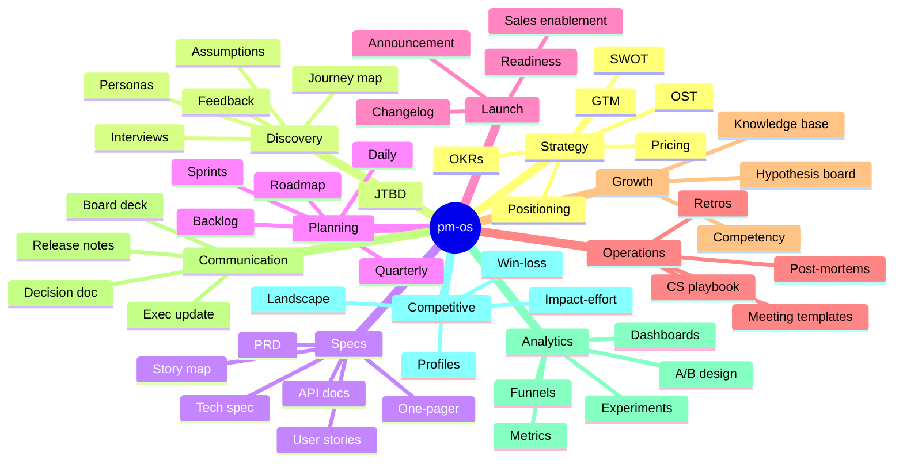
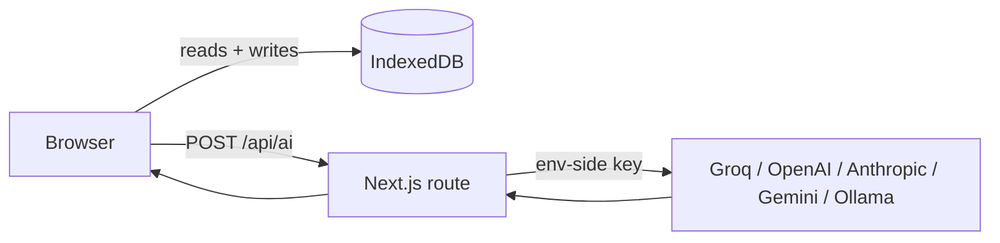

<div align="center">

# pm-os

**The Product Management Operating System**

82 PM modules across 10 disciplines (strategy, discovery, specs, planning, launch, ops, growth, comms, analytics, competitive), 81 with AI drafting. Local-first, keyboard-driven.

[](LICENSE)
[](https://nextjs.org)
[](https://react.dev)
[](https://tailwindcss.com)

</div>

---

## What it does

pm-os is a single-user, local-first workspace for the documents PMs otherwise scatter across Notion, Linear, Miro and Google Docs. It has no collaboration or sync, so it complements those tools rather than replacing them for a team.

There are 82 PM modules. 57 are guided document forms that share one drafting flow: you fill in a few fields and a module-specific LLM prompt turns them into a draft artifact (a PRD, an OKR set, a persona, a release plan, and so on). 24 are custom trackers and canvases (backlog, risk register, story map, OST, and others) with an AI Analyze button. One (the knowledge base) is static reference content with no AI call. 81 module prompts live in `src/lib/ai-prompts.ts`.

Everything lives in your browser (IndexedDB). The only thing that leaves your machine is the LLM call when you click _Generate_. Switch LLM providers — **Groq, OpenAI, Anthropic, Gemini, or local Ollama** — without touching code.

---

## The 10 disciplines



Each module follows the framework PMs already use (April Dunford for positioning, Teresa Torres for opportunity trees, Cooper for personas, Lenny's PRD template, etc.).

---

## Quickstart

```bash
git clone https://github.com/avinashgaurav/pm-os.git
cd pm-os
npm install
cp .env.example .env.local
```

Edit `.env.local` and set **any one** provider key:

```bash
GROQ_API_KEY=gsk_...           # free tier — https://console.groq.com/keys
OPENAI_API_KEY=sk-...          # https://platform.openai.com/api-keys
ANTHROPIC_API_KEY=sk-ant-...   # https://console.anthropic.com/settings/keys
GOOGLE_API_KEY=...             # https://aistudio.google.com/apikey
OLLAMA_URL=http://localhost:11434  # if running Ollama locally
```

Then run:

```bash
npm run dev
```

Open [http://localhost:3000](http://localhost:3000) → **Settings** → pick a provider + model → start generating. Providers without a key are greyed out.

---

## Architecture



- **Frontend:** Next.js 16, React 19, Tailwind 4, shadcn/ui, Base UI, Framer Motion, Recharts.
- **State:** Zustand for UI, Dexie/IndexedDB for everything persistent.
- **AI:** thin client → server-side `/api/ai` route → provider gateway. Keys live in env vars, never in the browser bundle.

Adding a provider is one file (`src/lib/providers/`). Adding a module is one route under `src/app/<category>/<slug>/page.tsx` + a prompt entry in `src/lib/ai-prompts.ts`. An architecture deep-dive is tracked in [#29](https://github.com/avinashgaurav/pm-os/issues/29).

---

## Deploy

[](https://app.netlify.com/start/deploy?repository=https://github.com/avinashgaurav/pm-os)
[](https://vercel.com/new/clone?repository-url=https://github.com/avinashgaurav/pm-os)

Set provider env vars in the host UI. For self-hosting, any Node host that runs Next.js works — `npm run build && npm start`.

---

## Status

Actively built. All 82 modules run locally once you configure your own provider key; the hosted demo has no key configured, so AI drafting does not work there. Polish, sync, and richer editing are planned as separate PRs.

- **[Open issues](https://github.com/avinashgaurav/pm-os/issues)** — infrastructure backlog (CI, tests, Sentry, Zod, exports…)
- **[Feature roadmap (#32)](https://github.com/avinashgaurav/pm-os/issues/32)** — 50 product ideas (rich editor, backlinks, AI coach, integrations, multi-workspace…)

Contributions welcome. Start with issues labeled `priority:low` or `area:docs`.

---

## Status and limitations

- **Hosted demo needs a key.** The public deploy has no provider key, so Generate and Analyze fail there. Run locally with your own key to try the AI features.
- **No unit tests yet.** CI runs typecheck, lint, build and secret scanning only.
- **The AI endpoint has no auth or rate limit by default.** `/api/ai` accepts any request unless `PM_OS_API_TOKEN` is set, and the browser client does not send that token yet. Do not deploy publicly with a provider key until auth and rate limiting are added.
- **Prompt evals have not run yet.** The eval harness (`evals/`, `npm run eval`) and its nightly GitHub Actions job exist, but the job skips when no provider key secret is set, and none is set, so no snapshots have been produced.

---

## Privacy

Your data stays in your browser's IndexedDB. The only outbound request is the LLM call when you click _Generate_. Export everything anytime: **Settings → Export All Data**.

---

## License

MIT — see [LICENSE](LICENSE). Built by [@avinashgaurav](https://github.com/avinashgaurav).
