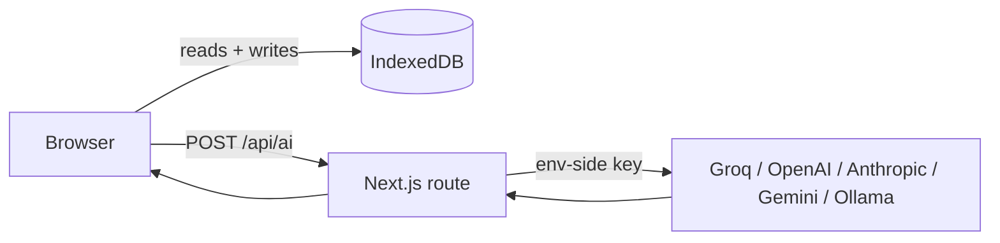

## Architecture

- **Frontend:** Next.js 16, React 19, Tailwind 4, shadcn/ui, Base UI, Framer Motion, Recharts.
- **State:** Zustand for UI, Dexie/IndexedDB for everything persistent.
- **AI:** thin client → server-side `/api/ai` route → provider gateway. Keys live in env vars, never in the browser bundle.

Adding a provider is one file in `src/lib/providers/` plus its id in `src/lib/providers/types.ts` and a registry entry in `src/lib/providers/index.ts`. Adding a module is one route under `src/app/<category>/<slug>/page.tsx` + a prompt entry in `src/lib/ai-prompts.ts`. An architecture deep-dive is tracked in [#29](https://github.com/avinashgaurav/pm-os/issues/29).

## Deploy

Set provider env vars in the host UI. For self-hosting, any Node host that runs Next.js works: `npm run build && npm start`.
