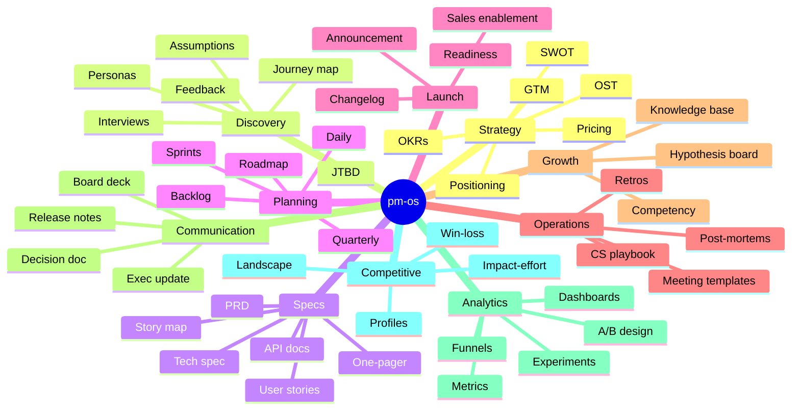

# What pm-os does

pm-os is a single-user, local-first workspace for the documents PMs otherwise scatter across Notion, Linear, Miro and Google Docs. It has no collaboration or sync, so it complements those tools rather than replacing them for a team.

There are 82 PM modules. 57 are guided document forms that share one drafting flow: you fill in a few fields and a module-specific LLM prompt turns them into a draft artifact (a PRD, an OKR set, a persona, a release plan, and so on). 24 are custom trackers and canvases (backlog, risk register, story map, OST, and others) with an AI Analyze button. One (the knowledge base) is static reference content with no AI call. 81 module prompts live in `src/lib/ai-prompts.ts`.

Everything lives in your browser (IndexedDB). The only thing that leaves your machine is the LLM call when you click _Generate_ or _Analyze_. Switch LLM providers (**Groq, OpenAI, Anthropic, Gemini, or local Ollama**) without touching code.

## The 10 disciplines

Many module prompts name the framework PMs already use (April Dunford for positioning, Teresa Torres for opportunity trees, Cooper for personas, Christensen for jobs-to-be-done).
